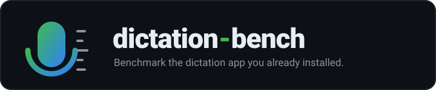
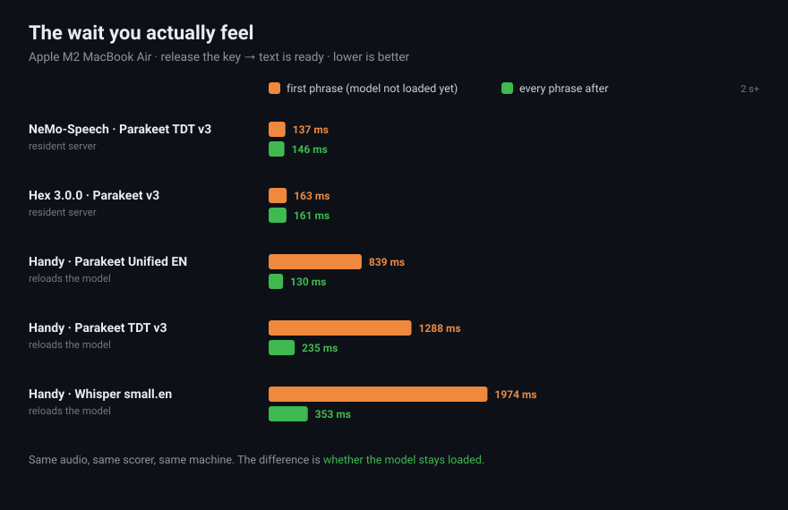
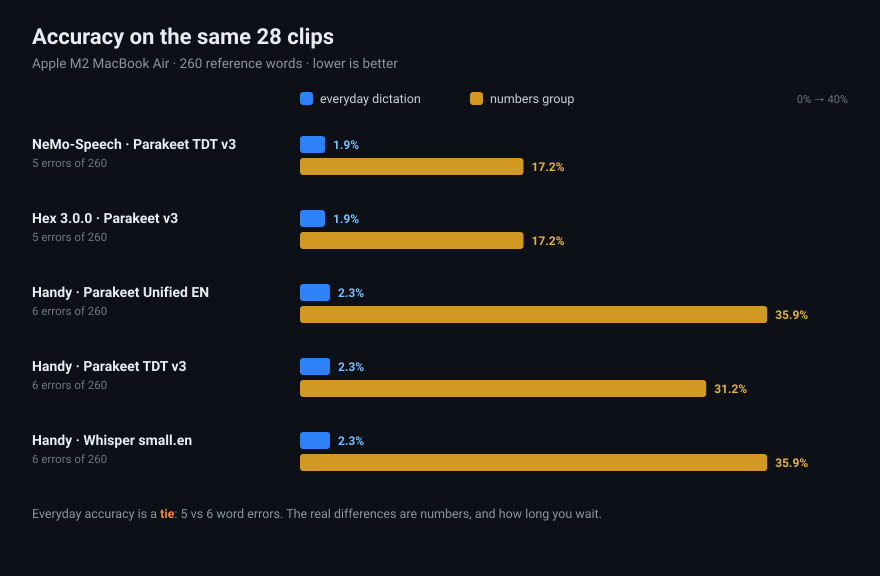

<div align="center">



**Benchmark the dictation apps you already have installed, on your own machine.**

[](https://github.com/jimaldon/dictation-bench/actions/workflows/ci.yml)
[](https://www.python.org/)
[](#quick-start)
[](LICENSE)

[Quick start](#quick-start) | [Supported dictation software](#supported-software) | [Method](#method)

</div>

---

## The problem

Picking a dictation app should take ten minutes. You search and get a wall of options: Wispr Flow,
the macOS built-in, Handy, FluidVoice, VoiceInk, Superwhisper, Hex, MacParakeet, OpenWhispr,
WhisperKit, whisper.cpp. Most of them are good. Each has a benchmark table on its README or blog,
and the tables disagree with each other about the same models.

Three things account for most of that disagreement, and each one changes the answer you would
arrive at:

1. **Scorers differ.** One table lowercases and strips punctuation. The next converts "twenty
   twenty six" to "2026" on one side of the comparison only. The same pair of engines can swap
   places.
2. **"Speed" is not one number.** A model can hit 200x real time on a long file and still take
   two seconds on the first phrase after launch, because the model is loading. What you notice is
   the wait, and there are two different waits.
3. **Small corpora make ties look like wins.** "1.9% vs 2.3%" on a 260-word test set is five
   errors against six. Presented as a ranking, that reads far stronger than the evidence supports.

## What it does

`dictation-bench` runs the software installed on this machine against one fixed audio set, with
identical scoring for every candidate, and reports accuracy, both latencies, and the trade-offs. It
takes a couple of minutes per engine.

<div align="center">

</div>

## Quick start

Python 3.10 or newer, plus `sox` (`brew install sox`). No API keys, no account, nothing leaves the
machine.

```bash
git clone https://github.com/jimaldon/dictation-bench && cd dictation-bench
pip install -e ".[normalize]"
dictation-bench doctor
```

Then point it at two things you want to compare:

```bash
dictation-bench bench --preset nemo-speech-server --preset whisper-cpp-cli
```

Or list everything you care about in a `bench.toml`:

```bash
dictation-bench init && dictation-bench bench
```

The result lands in `results/report.md`. Each engine gets a short pros and cons list, and the report
ends with the recommendation and the reasons that would change it:

```
+ Resident (no reload per phrase)      ! Slow first phrase (1974 ms vs 353 ms): the model is
+ Offline (no network)                   loaded per invocation, so every relaunch pays this once
! Misreads numbers (35.9% on the numbers group)
```

## What it produced on one laptop

Machine: Apple M2 MacBook Air, 24 GB, macOS 26.7.1, on AC power. Corpus: the 28 bundled clips
(112.8 s), with 260 reference words in the headline score. Five systems installed side by side, run
one after another on 2026-10-31.

| System | How it ran | Everyday WER | Numbers | First phrase | Every phrase after |
|:--|:--|--:|--:|--:|--:|
| [NeMo-Speech.cpp](https://github.com/NVIDIA/NeMo-Speech.cpp) with [Parakeet TDT v3](https://huggingface.co/nvidia/parakeet-tdt-0.6b-v3) | resident server, Metal | **1.9%** | 17.2% | **137 ms** | **146 ms** |
| [Hex 3.0.0](https://github.com/anomalyco/hex) with Parakeet v3 | resident service | **1.9%** | 17.2% | 163 ms | 161 ms |
| [Handy](https://github.com/cjpais/Handy) with Parakeet Unified EN | app binary, batch mode | 2.3% | 35.9% | 839 ms | 130 ms |
| [Handy](https://github.com/cjpais/Handy) with Parakeet TDT v3 | app binary, batch mode | 2.3% | 31.2% | 1288 ms | 235 ms |
| [Handy](https://github.com/cjpais/Handy) with [Whisper small.en](https://huggingface.co/openai/whisper-small.en) | app binary, batch mode | 2.3% | 35.9% | 1974 ms | 353 ms |

<div align="center">

</div>

Reading the table: everyday accuracy is a tie. NeMo-Speech and Hex miss five words out of 260, the
three Handy configurations miss six. I would not pick between them on that.

The two differences that hold up are written numbers and waiting. The resident setups get 17.2%
wrong on the numbers group; Handy's models land between 31 and 36%. Handy's warm column comes from
its internal inference timer and excludes the model load, but the cold column is real wall time, so
the 0.8 to 2.0 s first phrase stands. Inside the app the model stays loaded and that first phrase
should feel like the others. I did not verify that by driving the GUI, so treat it as the expected
behaviour of a resident app rather than a measurement.

So the choice comes down mostly to shape: a menu bar app you click, or a server you bind to a key
and keep running. Accuracy does not settle it and neither does speed once the model is warm.

The full report, unedited, with per-group accuracy, 95% ranges and the per-engine pros and cons:
[examples/report-m2-macbook-air.md](examples/report-m2-macbook-air.md).

One caveat carries over from that report. Handy's "every phrase after" is its internal inference
timer, not wall time, and the report says so in its own "Before you trust this" section. That is the
kind of thing this tool is meant to surface rather than hide.

## Supported software

There is no plugin per app. There are four ways in, which between them cover most local dictation
software, open source or not:

| What your software exposes | `type` | Examples |
|:--|:--|:--|
| An OpenAI-compatible `POST /v1/audio/transcriptions` | `http` | whisper.cpp server, WhisperKit server, NeMo-Speech, faster-whisper-server, LM Studio |
| A command that prints text on stdout | `cli` | `whisper-cli`, `whisperkit-cli`, `moonshine`, `hns`, `parakeet.cpp` |
| A command that prints JSON | `json-cli` | [Handy](https://github.com/cjpais/Handy)'s batch mode, [Hex](https://github.com/anomalyco/hex)'s service |
| Anything you can script | `custom` | a wrapper around a GUI-only app |

Several GUI apps ship a hidden CLI or a local server; Handy does. Check `<app> --help` and
`lsof -nP -iTCP -sTCP:LISTEN` before assuming there is nothing to drive. If there really is nothing,
wrap the app with `type = "custom"` and the report will mark those numbers as yours rather than the
project's. The full guide is [docs/adding-an-engine.md](docs/adding-an-engine.md).

Presets included: whisper.cpp server and CLI, WhisperKit server and CLI, NeMo-Speech,
faster-whisper-server, LM Studio, Moonshine, hns, parakeet.cpp, Handy. Run `dictation-bench engines`
to list them, or see [examples/bench.example.toml](examples/bench.example.toml).

## Your own voice and microphone

The bundled corpus is synthetic and cleaner than any room. Your microphone probably matters more
than your choice of model, and no published table can measure it. Three ways to fix that:

```bash
dictation-bench corpus --from-clip my-voice.wav --ref "the exact words I said"
dictation-bench corpus --from-text-file my_sentences.txt --out corpus/mine
dictation-bench corpus --from-macos-say --pollute --out corpus/party
```

The third renders the default corpus with a second voice talking over you, which is where models
that look identical on clean audio start to separate.

## Building the stack instead of buying it

If no app fits, [docs/recipe/dictation.md](docs/recipe/dictation.md) has the minimal version this
project came out of: one resident server under `launchd`, a shell script of about 150 lines, and
whatever hotkey you already use. It is deliberately not an app.

## Method

Every engine is scored three ways: naive, Whisper-style, and number-aware. The report prints all
three, so you can see when the scorer is deciding the ranking rather than the software.

In the run above all three scorers agree, 5.9% and 9.6% on the same transcripts. That means the gap
between those systems is real rather than a formatting artifact, which is only knowable because the
scorer was tested instead of assumed. Where a scorer does move the numbers, the report shows by how
much. Details, including why both sides are normalised identically, are in
[docs/methodology.md](docs/methodology.md).

| Axis | What it measures | Where it can mislead |
|:--|:--|:--|
| Accuracy | WER on your corpus, three normalisers. The headline covers prose, jargon, long clips and background speech. | Synthetic speech is easy, and small corpora make one word look like a trend. Both are printed. |
| First phrase | First clip with the engine not yet used: process start, model load, shader compile. | Includes start-up that a long-running app never pays again. |
| Every phrase after | Median over the remaining clips. | Engine time only, without audio capture or the paste keystroke. |
| Capabilities | Declared per engine: partials, resident, vocabulary, offline. | Declared, not measured. The report does not infer them. |

## Limitations

This is an engine benchmark, not a product review. It does not measure the interface, the price, the
privacy policy, the licence or the support, and for many people those matter more than half a
percent of word error rate. It cannot fairly drive a closed app's GUI. It measures one machine on
one day, so treat the numbers as a comparison for you rather than a ranking of the world, and re-run
after a model upgrade.

The default corpus is 28 clips and about 113 seconds, enough to separate engines that differ by
whole points. It is not enough to rank engines that differ by one word, and the report says so when
that happens.

## Contributing

The most useful contributions, in order: a preset for software you actually use, especially the GUI
apps people are choosing between; real recordings with their exact text, which is the scarcest input
in speech recognition; and normaliser rules with a test that shows what they change. Details are in
[CONTRIBUTING.md](CONTRIBUTING.md).

<details>
<summary>Development</summary>

```bash
pip install -e ".[dev]"
python -m pytest tests -q
ruff check src tests
```

Source lives in `src/dictation_bench`, the corpus in `testdata/reference`, the docs in `docs/`, and
the dictation script in `scripts/dictbench-ptt`. CI runs on Linux and macOS for Python 3.10 through
3.13, builds the wheel, and shellchecks the script.

</details>

## License

MIT for this project's code. The dictation software, models and corpora keep their own licences.
This repository ships no models.
